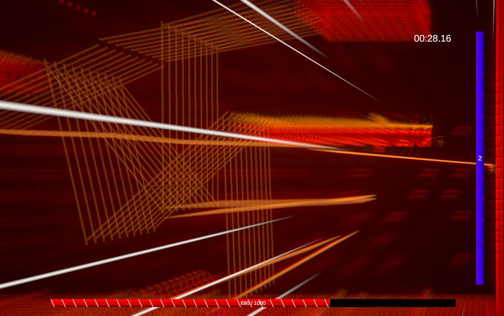
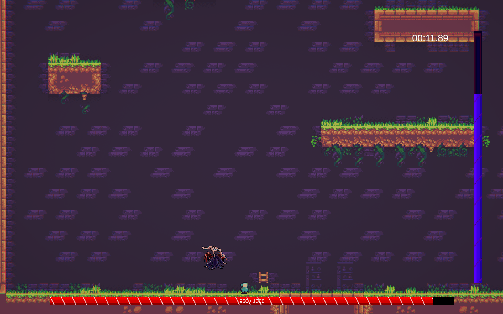

# Flow Fight

A 2D hack-n-slash built for a game jam. Theme: **flow**, with a focus on movement and bosses.

Fight a boss, keep your attacks landing without getting hit, and build up your **Flow gauge**. When it fills, you enter **Flow state** and unleash a storm of teleport-slashes.

*Normal state: you (bottom center) face the boss. The red bar is the boss HP, the purple bar is the Flow gauge, and the top right shows the elapsed time.*

## Controls

| Input | Action |
|---|---|
| **A / D** | Move left / right |
| **Space** | Jump (up to 3 times in the air) |
| **Mouse** | Aim. Attacks follow the cursor |
| **Left click** | End Flow early (only during Flow) |

Attacks are automatic, so you only need to move and aim.

## How to play

### 1. Normal state: build Flow
- You automatically swing a half-circle slash toward the mouse cursor every 0.5 seconds.
- Each swing that hits the boss fills the Flow gauge.
- Getting hit costs you HP and drains some Flow. Stop landing hits and the gauge slowly decays.
- Dodge, jump and keep the pressure on.

### 2. Flow state: dash-slash
In the banner image above, the screen turns red, the boss slows down, and each dash leaves a trail. The number on the Flow bar is the dashes remaining.

When the gauge is full, Flow starts automatically.

- Every 0.3 seconds you **teleport toward the mouse cursor** and leave a glowing trail. Dashes stop at walls.
- You can still move and jump between dashes, and you are **not** invincible.
- The boss moves at about 1/3 speed.
- Dashes deal no damage at the moment you use them. The damage comes when Flow ends.

**Flow ends when** any of these happens:
- You use all 15 dashes.
- You teleport into the boss.
- You left-click.

When it ends, **every trail deals damage to whatever it passed through**. A boss crossed by several trails takes damage from each of them, so lay your dashes across the boss to stack damage. The Flow gauge then resets to 0.

## Win / lose
- **Win:** reduce the boss HP bar to 0.
- **Lose:** your HP reaches 0. Touching the boss hurts, and you get a short period of invincibility after each hit.
